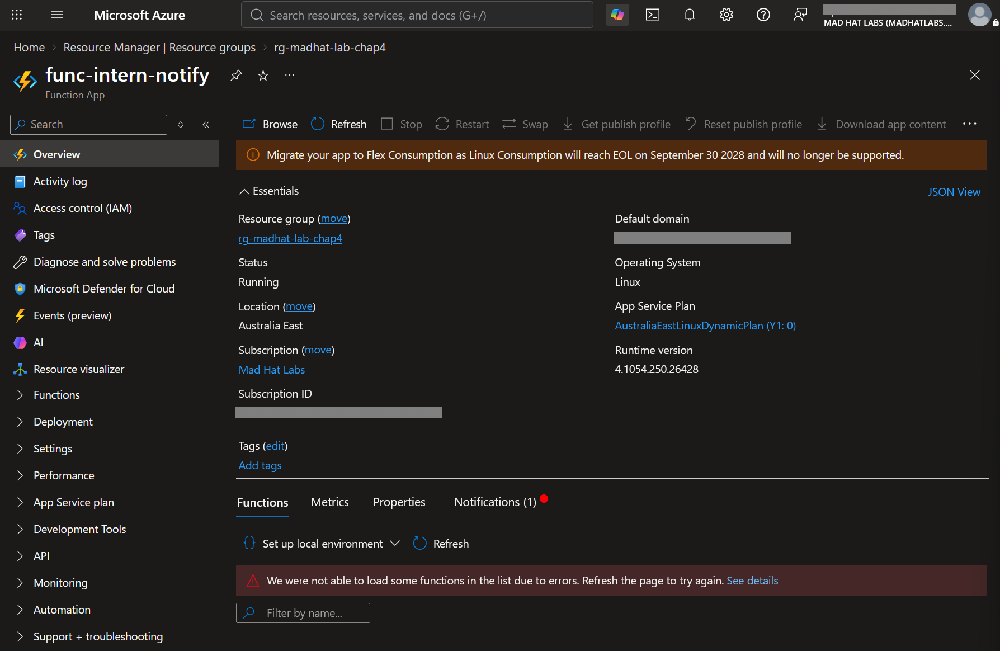
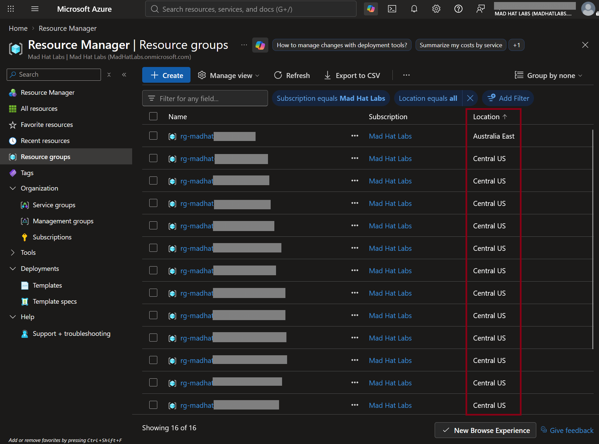
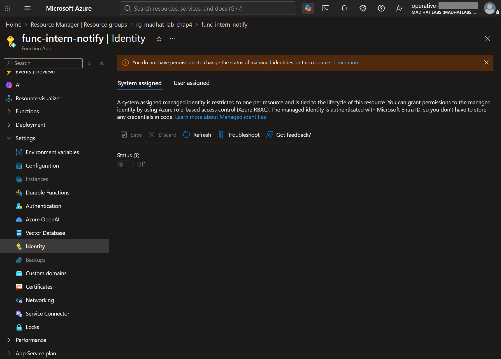
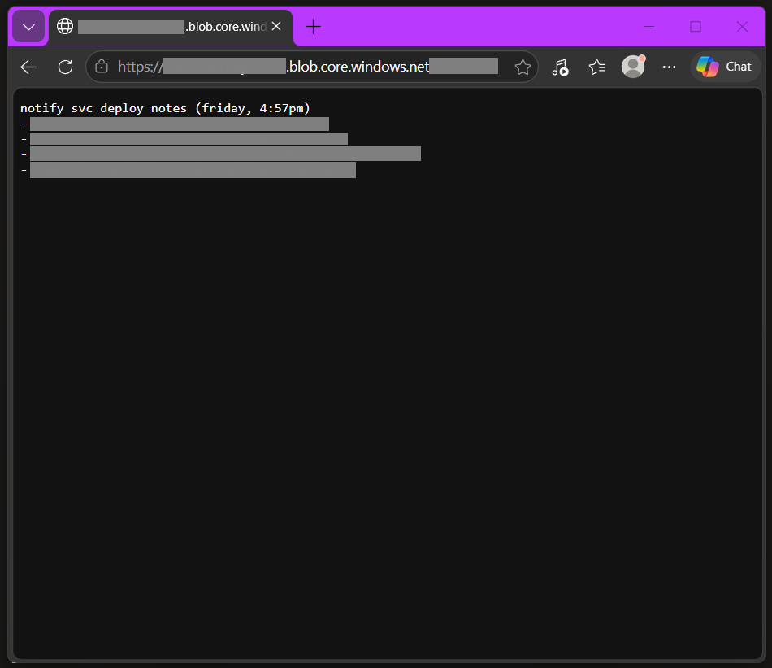
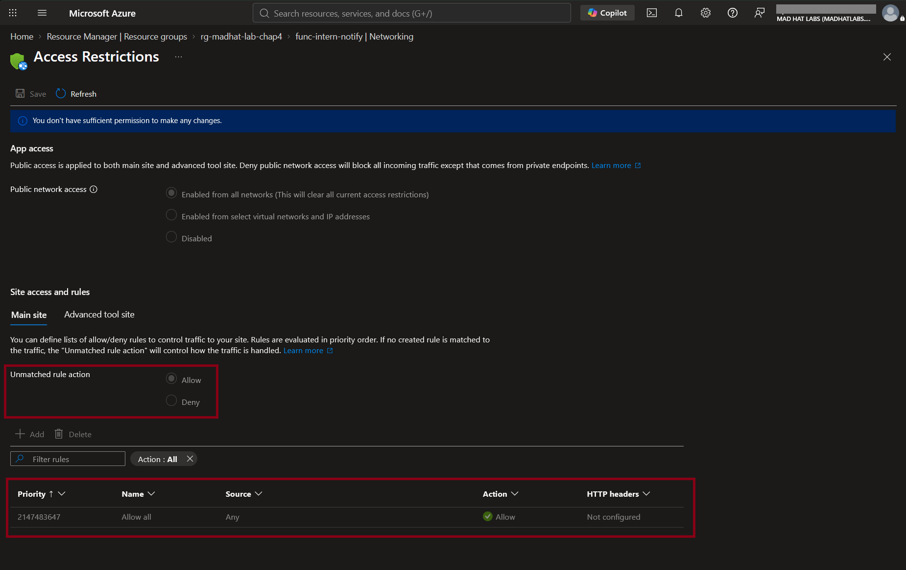

# The Friday Deploy

## Scenario
The intern shipped a new notification service Friday at 4:57pm. Now it's Monday and nobody has looked at it since deployment. I have reader access and need to review the deployment before it ships to production.

## Method
There is no written standard, so I must derive the standard from the existing infrastructure. I will review the deployment across five key areas; location, workload identity, data exposure, user access, is it ready for deployment?

## The Priority Call
> Prioritization principle - Exposeure beats hygiene. Active beats potential.

| Priority | Severity | Finding | Impact |
| :------- | :------- | :------ | :----- |
| Priority 1 | Critical | Blob container set to public anonymous access | This is an active data leak exposure, visible to anyone on the internet  without authentication |
| Priority 2 | High | All inbound traffic allowed to App | Internal endpoints exposed to scanning, abuse, and potential exploitation |
| Priority 3 | High | App is Missing Managed Identity | Credentials likely hardcoded in app or settings |
| Priority 4 | Medium | Wrong region | Increased latency AND data egress costs |

## THE WHERE. Is it even in the right place?
**What I observed:** The application was deployed to a different region than the existing baseline. The application is in Australia East.

**How I verified:** Inspected the resource group properties and found that all other resource groups are within the US.

**Why it matters:** Increased network latency, unnecessary cross-region data egress charges.

**What to do:** Redeploy the resource group and all associated resources into the standard region.

  

## THE WHO. How does it authenticate to what it depends on?
**What I observed:**  The application has no managed identity attached.

**How I verified:** Checked the Identity blade of the function app.

**Why it matters:** Hardcoded or stored credentials increase the risk of leaked credentials and administrative overhead.

**What to do:** Attach a system-assigned managed identity.

## THE LEAK. Where does its data actually sit?
**What I observed:** A blob storage container was configured for anonymous public access.

**How I verified:** Copied the public blob URL and successfully retrieved the stored file from an unauthenticated private browser window.

**Why it matters:** Active data leak. Data in the blob storage container is actively exposed to anyone on the internet without authentication.

**What to do:** Disable anonymous public access on the blob storage container immediately and secure data access over private routes.

## THE DOOR. Who can reach it?
**What I observed:** The function app had zero inbound access restrictions.

**How I verified:** Reviewed the access restriction rules under the application's networking configuration.

**Why it matters:** By default, if there is no inbound access restrictions then the *Allow all* rule is left open.

**What to do:** Add a single explicit inbound deny rule to block public.

## REMEDIATION RECOMMENDATIONS
- Close the public container immediately.
- Attach a user-assigned managed identity with a scoped role on the storage account and remove the stored credential.
- Redeploy into the platform's standard region.
- Add a single deny rule to close inbound, since one rule flips everything unmatched to implicit deny.
- A deploy checklist so the next Friday afternoon does not need a human to catch four things.

## Key takeaways
### What I learned
- On the function app, the default network config for public access is the *Allow all* rule. An explicit deny rule must be configured manually.
- I learned about data egress costs. Every call that the service makes now increases the cloud bill. 
