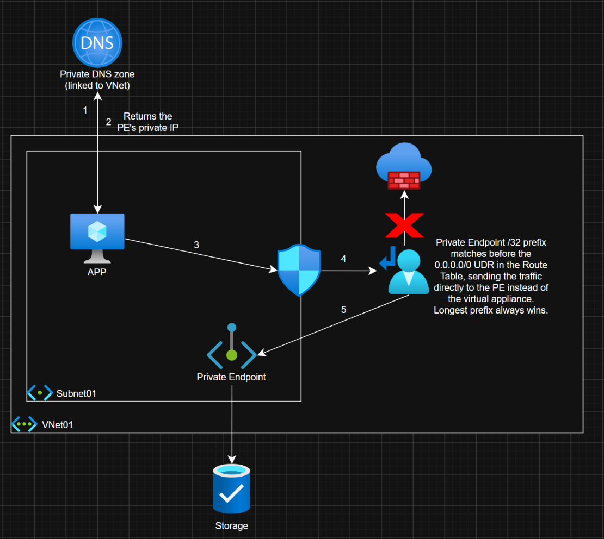
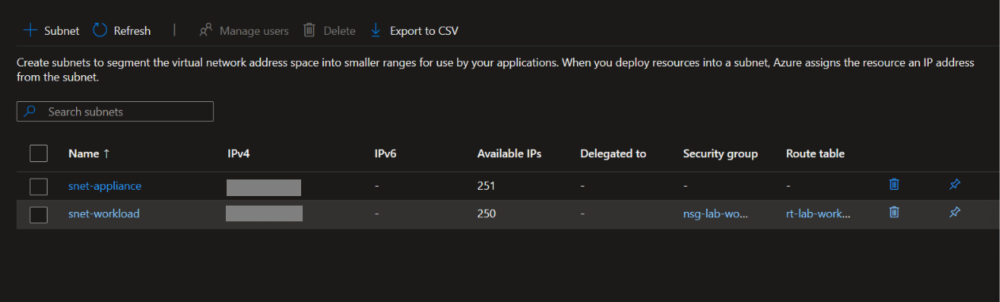
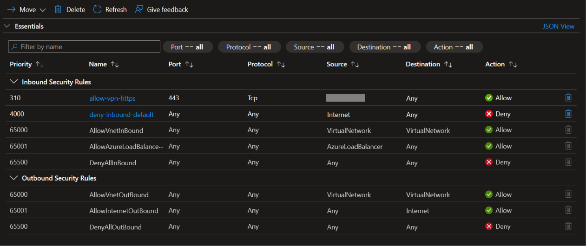
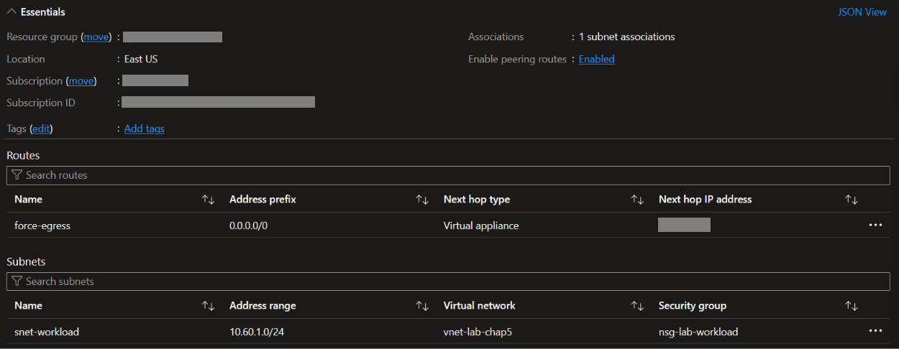
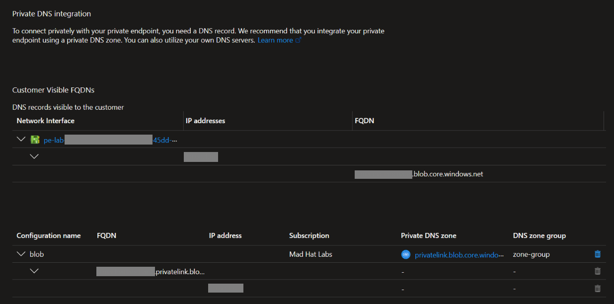
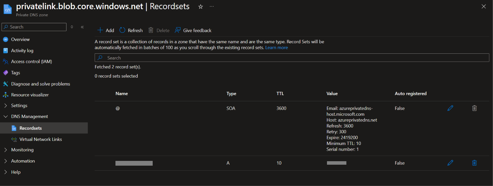

# Network Like an Operative

## The Ticket
>App team 10/16/2026 08:49am  
our new service can reach the customer-data storage account, but I don't understand why or how. Can someone walk me through the network path?
Thanks,
App team

## My Reply
>Steve Hudy 10/16/2026 11:43am  
The app is asking for the storage account by hostname. A query to the private DNS zone resturns the IP address in the same subnet, belonging to a Private Endpoint. The Private Endpoint creates a /32 prefix route that matches the traffic before the 0.0.0.0/0 "forced tunnel" UDR, because longest prefix always wins. The key takeaway here is that the packet never leaves the VNet and never routes through the firewall.

## Findings Overview
## Traffic flow diagram

## Finding 1: The VNET
Every trace starts with the same question. What is the source of the traffic? We can find the source by looking at the vnet that the workload lives in. Here we see the subnet for the workload, with the assigned security group and reoute table.

## Finding 2: The NSG
The next step is to check the Network Security Gateway. Here I found a couple custom inbound rules. One allowing HTTPS traffic from a single IP address source, the next is a deny anything else.  
The outbound rules are deafult. Allowing any necessary outbound traffic through, to another vnet or to the internet.

## Finding 3: The Route
Checking the route table will tell me where the traffic is supposed to go next. I see a "forced tunnel" route, all traffic (desination 0.0.0.0/0) is sent to a virtual appliance with a single IP. When traffic is being fowrarded, it will take the route with the longest prefix match.

## Finding 4: The Private Endpoint
The traffic is not hitting the virtual appliance for inspection. The next hop, the Private Endpoint. The Private Endpoint is in the same subnet, which quietly injects its own system route that routes directly to it's IP address, a /32 subnet mask. This beats the forced tunnel route in the route table.

## Finding 5: The Name
When the app attempts to connect to the storage by hostname, it reaches out to a private DNS zone. The private DNS zone holds an A record (maps hostname to IPv4) for the storage account.

## What I learned:
A network security group applied to a subnet, effectively applies the ACLs to each NIC individually. So the ACLs are evaluated and apply even if the destination is on the same subnet.

When a Route Table is evaluating traffic, the longest prefix wins. Even if there is a forced tunnel route, ANY traffic goes to a single destination, a Private Endpoint will register a route to it's /32 prefix and override the forced tunnel.